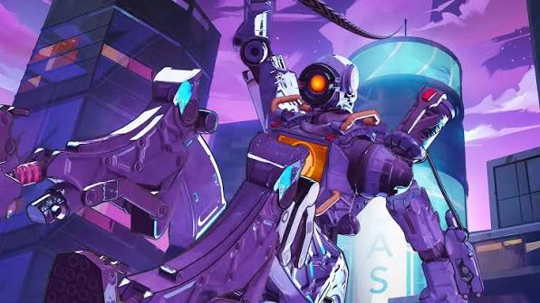

# Introduction 
Hi! I'm CHEAN SHIE ZHEN but my friends usually call me ERNEST. Currently, I'm a student in the Software Maintenance and Evolution course.  I expect to learn a lot about modern software maintenance practices and how to work with legacy systems. 

- **Fun fact**: I am a huge fan of video games and my all time favourite is Apex Legends. The image showcases my favourite character Pathfinder :)
- **Course expectations**: To gain hands-on experience in maintaining and evolving software.
-  
